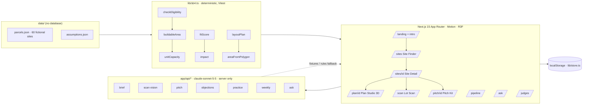

# Keystone — find the land, unlock the homes

**Lane: Find it.** Keystone is Habitat for Humanity of Orange County's land engine. It finds faith- and college-owned parcels that California SB 4 lets Habitat build on by right, measures buildable space (even from a satellite screenshot), designs a feasible site plan in 3D, pitches it to the congregation in their language, and tracks every site from first contact to groundbreaking. *Homeownership that holds.*

Live: https://keystone-oc.vercel.app · Judge Guide: https://keystone-oc.vercel.app/judges

## Why SB 4 matters

Habitat can't sell homes it can't build, and in Orange County it can't build without land. Land, not families or volunteers, limits how many homes Habitat OC delivers. Today finding land is luck: Habitat waits until a city happens to offer it.

SB 4, the Affordable Housing on Faith and Higher Education Lands Act of 2023 (Gov. Code § 65913.16), took effect July 2, 2024 and sunsets January 1, 2036. Land owned by a religious institution or an independent nonprofit college on or before January 1, 2024 can be developed for affordable housing with ministerial, by-right approval, without discretionary or CEQA review, if the project meets objective standards: all units for lower-income households (up to 20 % moderate income, up to 5 % institution staff), a 45-year deed restriction for ownership housing (55 for rental), a minimum density of 30 units/acre in a metropolitan county like Orange County (40 where the zone doesn't allow residential use), one story above the local height limit, and a Phase I environmental site assessment. A UC San Diego study found faith-based organizations own about 3,600 acres across 1,300 parcels in San Diego County alone, enough for roughly 4,900 affordable homes if just 10 % were developed.

Sources: [HCD SB 4 fact sheet](https://www.hcd.ca.gov/planning-and-community-development/housing-open-data-tools/sb-4), [UC San Diego Center for Housing Policy and Design report on faith-owned land](https://housingpolicy.ucsd.edu/), [Gov. Code § 65913.16](https://leginfo.legislature.ca.gov/faces/codes_displaySection.xhtml?sectionNum=65913.16.&lawCode=GOV). Challenge framing ($1.47M median OC home, ~4 years land to keys, 34 cities, families can pay 30–35 % of income): Claude Impact Lab challenge brief. **Not legal advice. Confirm with the city and counsel.**

## Architecture



## Claude usage

| Route | Purpose | Input | Output | Fallback |
|---|---|---|---|---|
| `POST /api/brief` | Feasibility brief grounded in engine numbers | parcelId, keepSpaces | streamed Markdown | rules-based brief |
| `POST /api/scan` | Satellite screenshot → polygons (buildings, parking, open land, trees, access) | image, metersAcross | Zod-validated JSON | sample fixtures / manual tracing |
| `POST /api/pitch` | Letter to the congregation (EN/ES/VI/KO) | parcelId, lang | streamed text | template letter |
| `POST /api/objections` | Six board objections with answers | parcelId | JSON | static answers |
| `POST /api/practice` | Skeptical board member, then feedback | transcript | JSON | scripted turns |
| `POST /api/weekly` | Pipeline weekly brief | entries | streamed text | rules-based brief |
| `POST /api/ask` | SB 4 Q&A citing fact ids | question | streamed text + `FACTS:` line | keyword match |

Every route validates input and output with Zod, times out at 25 s, retries once, logs purpose and token counts, returns `{ error: { code, message } }` on failure, and works without a key. `MOCK_CLAUDE=1` serves `fixtures/`. Claude never decides eligibility or numbers; the engine does.

## Engine rules (lib/sb4.ts)

- Eligible owner: congregation or independent nonprofit college; owned on or before 2024-01-01; today within 2024-07-02 … 2036-01-01. Flood zones and hazards are warnings, never silent passes.
- Minimum density 30 units/acre, 40 where zoning isn't residential.
- Buildable area = open land + parking freed (350 sq ft per kept space) − 10 % setbacks, never below zero.
- Practical capacity: townhomes ≈ 1,850 sq ft of land per home; stacked flats ≈ 750 sq ft, capped at 1.1× the SB 4 minimum. Townhomes short of the minimum get a stacked-flats suggestion.
- Fit score 0–100 (buildable acres, transit, schools, grocery, slope, hazards, eligibility) with a per-factor breakdown. Impact: homes, people (×3.4), affordability-years (×45).
- `layoutPlan` places rows of homes, a drive aisle, kept stalls, yards and a community green inside the set-back polygon, never overlapping and never outside the lot.
- "Closes the gap" (lib/gap.ts) is an illustrative per-home cost stack from `data/assumptions.json`. All money and time figures are labeled illustrative.

## Setup

```bash
npm install
cp .env.example .env.local   # add APP_ANTHROPIC_API_KEY (optional; fallbacks work without it)
npm run dev
npm run check                # tsc · eslint · vitest · next build
```

`npm run e2e` runs Playwright with `MOCK_CLAUDE=1`. Deploys: every push to `main` builds on Vercel.

## Demo script (3 minutes)

1. Load the site: blueprint, the arch builds, the keystone locks, the camera dives into Orange County, parcel dots appear, "Keystone" fills the screen, then the hero.
2. "Habitat OC's limit isn't families. It's land. Since July 2024, California's SB 4 lets churches and nonprofit colleges build affordable homes on their own land by right. Almost nobody is using it."
3. Press Down through "The challenge", "The law changed in 2024", "How it works" (Find · Check · Design · Partner) and "Searching vs. waiting": the cost stack shrinks, the empty lot fills with homes while the church keeps its parking, and the headline metric shows 48× more options, about 480× faster vetting and $100,000 less land per home (editable assumptions with sources).
4. Site Finder: filter to eligible sites near transit; totals roll.
5. Open a sample church: eligibility explained; drag "keep parking" from 120 to 60 spaces; homes jump; the gap closes.
6. Lot Scan: drop a satellite screenshot; Keystone outlines parking and open land and computes buildable area.
7. Plan Studio: generate; townhomes build row by row; toggle before/after; sweep the sun.
8. Pitch Kit: the letter writes itself in Spanish; show the board's top objections.
9. Pipeline: move the site to "Meeting set"; homes unlocked rolls up.
10. Toggle dark mode on the landing street: lamps flicker on one by one.
11. Close: "Keystone finds the ground. Habitat builds the homes."

## Performance notes

Measured on the production build at 4× CPU throttle with `scripts/dev/perf.mjs`: only the active landing section and its neighbours are mounted, markers are one CSS-driven SVG layer, the 3D canvas renders only while on screen, and no filters or layouts animate. Lighthouse mobile reports live in `docs/lighthouse/` (latest local runs: home 96–97, Site Finder 85–88; TBT is the noisy metric on a shared machine).

Illustration art that never changes at runtime is pre-rendered: `npm run gen:art` (also `prebuild`) writes the hero street (`public/art/hero-*.svg`, loaded as images) and the map detail layer (`public/art/map-detail-*.svg`); `npm run gen:raster` rasterises the latter to WebP with the bundled Chromium (output is committed; rerun it after changing `components/map/MapArt.tsx` or `ocArt.ts`). See `docs/DECISIONS.md` for why.

## What Habitat OC would need to adopt this

- **Real parcel data:** OC Assessor parcel roll (owner name, use code, acquisition date) joined to county GIS (zoning, hazard overlays, transit stops) in Postgres; a nightly job scores every parcel with the same engine.
- **Staff time:** about half a day a week for a land-partnerships lead to work the pipeline, plus planning counsel for pre-application meetings.
- **Monthly cost:** hosting on the order of tens of dollars, Claude usage a few dollars per hundred briefs and letters at current pricing, county data feeds per their licence.

## Sample data

Every parcel, congregation and address in this app is fictional and labeled "Sample data". No real congregation's name or address is used.

## Screenshots

See `docs/screenshots/` (every page and landing section at 1440×900, 1024×768 and 390×844, light and dark) and `docs/UI_REVIEW.md`.
